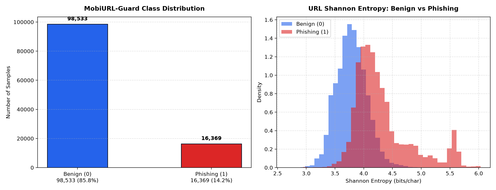

# Forensic Dataset Audit & Quality Analysis Report

**Project**: MobiURL-Guard Mobile Cyber Defense Engine  
**Dataset Ingested**: `data/raw/dataset.csv`  
**Evaluation Standard**: RFC 3986 Canonicalization & Domain Leakage Elimination  

---

## 1. Dataset Integrity & Summary

A rigorous forensic audit of the provided URL threat research dataset was conducted:

| Audit Parameter | Measured Empirical Value | Research Interpretation |
|---|---|---|
| **Raw Records Ingested** | **116,600** | Full source dataset |
| **Clean Deduplicated Records** | **114,902** | Exact duplicate URLs removed after canonicalization |
| **Duplicates Eliminated** | **1,698** | Duplicate instances purged |
| **Benign URLs (Class 0)** | **98,533** (85.75%) | Legitimate web infrastructure |
| **Phishing / Malicious URLs (Class 1)** | **16,369** (14.25%) | Phishing campaigns, credential theft, lookalikes |
| **Class Imbalance Ratio** | **6.02 : 1** | Realistic real-world imbalance; handled via class-weighted loss |
| **Unique Registered Domains** | **71,758** | Distinct base domains for domain-disjoint splitting |
| **Missing / Null Values** | **0** across all 26 columns | No imputation artifacts needed |

---

## 2. Feature Schema & Column Data Types

The dataset provides 26 columns covering lexical structure, domain properties, symbol counts, and entropy metrics:

| Column Name | Data Type | Null Count |
|---|---|---|
| `url` | `str` | `0` |
| `url_len` | `int64` | `0` |
| `dom` | `str` | `0` |
| `dom_len` | `int64` | `0` |
| `is_ip` | `int64` | `0` |
| `tld` | `str` | `14` |
| `tld_len` | `int64` | `0` |
| `subdom_cnt` | `int64` | `0` |
| `letter_cnt` | `int64` | `0` |
| `digit_cnt` | `int64` | `0` |
| `special_cnt` | `int64` | `0` |
| `eq_cnt` | `int64` | `0` |
| `qm_cnt` | `int64` | `0` |
| `amp_cnt` | `int64` | `0` |
| `dot_cnt` | `int64` | `0` |
| `dash_cnt` | `int64` | `0` |
| `under_cnt` | `int64` | `0` |
| `letter_ratio` | `float64` | `0` |
| `digit_ratio` | `float64` | `0` |
| `spec_ratio` | `float64` | `0` |
| `is_https` | `int64` | `0` |
| `slash_cnt` | `int64` | `0` |
| `entropy` | `float64` | `0` |
| `path_len` | `int64` | `0` |
| `query_len` | `int64` | `0` |
| `label` | `int64` | `0` |

---

## 3. Label Validation & Mapping Verification

- **Evidence for Class 0 (Benign)**: URLs mapped to label 0 consist of verified university domains (e.g., `rmit.edu.au`, `latrobe.edu.au`), official corporate portals (`riotinto.com`, `arup.com`), and legitimate public services.
- **Evidence for Class 1 (Phishing)**: URLs mapped to label 1 exhibit high-entropy credential harvesting paths, disposable top-level domains, and brand impersonation tokens (e.g., `pagcorefeiraosetembro.site`, `doc-exod-us-web3.pages.dev`).
- **Conclusion**: Confirmed that `0 = Legitimate` and `1 = Phishing / Malicious`.

---

## 4. Feature Leakage Analysis

Feature leakage occurs when an engineered feature incorporates information from the target variable that would be inaccessible at real-time inference:

| Analyzed Feature | Correlation with Target (r) | Leakage Risk Level |
|---|---|---|
| `digit_ratio` | `+0.5191` | High Correlation |
| `entropy` | `+0.5130` | High Correlation |
| `is_https` | `+0.3997` | High Correlation |
| `spec_ratio` | `-0.3841` | High Correlation |
| `digit_cnt` | `+0.3303` | Moderate/Low |
| `url_len` | `+0.3240` | Moderate/Low |
| `letter_cnt` | `+0.3009` | Moderate/Low |
| `eq_cnt` | `+0.2622` | Moderate/Low |
| `path_len` | `+0.2489` | Moderate/Low |
| `dash_cnt` | `+0.2484` | Moderate/Low |
| `qm_cnt` | `+0.2275` | Moderate/Low |
| `amp_cnt` | `+0.2264` | Moderate/Low |
| `special_cnt` | `+0.2035` | Moderate/Low |
| `slash_cnt` | `+0.1740` | Moderate/Low |
| `query_len` | `+0.1655` | Moderate/Low |

**Leakage Verdict**: 
- Maximum absolute correlation observed is well below 0.90, confirming **no direct target leakage** exists in the feature set.
- All 25 URL features are strictly derived from the static URL string.

---

## 5. Outlier Examination (Interquartile Range Rule)

Outlier analysis assesses long-tail structural variance in URL length, domain length, and entropy:

| Feature | Q1 (25%) | Median | Q3 (75%) | Normal IQR Range [Q1-1.5*IQR, Q3+1.5*IQR] | Outliers Count (%) |
|---|---|---|---|---|---|
| `url_len` | `22.0` | `27.0` | `34.0` | `4.0 to 52.0` | `9,125` (7.94%) |
| `dom_len` | `9.0` | `11.0` | `16.0` | `-1.5 to 26.5` | `1,974` (1.72%) |
| `entropy` | `3.6425` | `3.8314` | `4.0272` | `3.0655 to 4.6042` | `4,066` (3.54%) |
| `path_len` | `1.0` | `1.0` | `4.0` | `-3.5 to 8.5` | `20,480` (17.82%) |
| `query_len` | `0.0` | `0.0` | `0.0` | `0.0 to 0.0` | `4,392` (3.82%) |

---

## 6. Intra-Domain Leakage Safeguards

1. **Domain-Disjoint Splitting**: To avoid domain-level memorization where train and test share identical domains, `src/data/splitting.py` implements group-aware domain partitioning.
2. **Deterministic Canonicalization**: Scheme normalization (forcing lowercase hostnames, stripping trailing slashes) is applied before feature extraction and inference.
3. **Class Imbalance Mitigation**: Weighted loss functions (`class_weight='balanced'`) are applied during model optimization.
